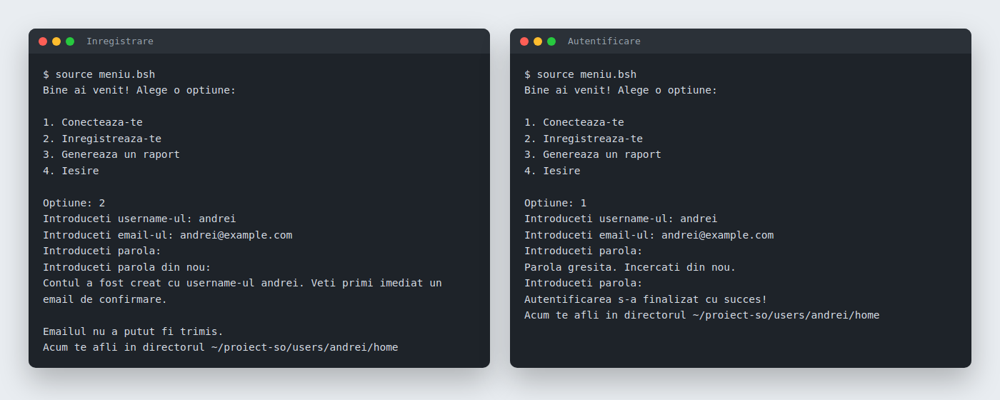

# User Management in Bash

Operating Systems course project: a terminal user-management system written in Bash. It handles sign-up, login and logout, password reset by email code, and disk usage reports per user. Users are stored in a CSV file and passwords as SHA-256 hashes.



## Features

- **Sign-up** (`signup.bsh`): checks that the username is free and valid, validates the email, asks for the password twice and stores only its SHA-256 hash. Each user gets a UUID, a row in `users.csv` and a home directory under `users/<username>/home`. A confirmation email goes out through `msmtp` when it's configured.
- **Login** (`login.bsh`): looks up the username and email, checks the password hash for that user, updates `last_login` with `sed` and moves the shell into the user's home directory. After three failed attempts it offers a password reset.
- **Logout** (`logout.bsh`): run from a user's home directory. It removes the user from the logged-in list and returns to the project directory.
- **Password reset** (`resetPass.bsh`): emails a 6-digit code, verifies it and replaces the stored hash.
- **Reports** (`raport.bsh`): counts files and directories and measures disk usage for one user or for everyone. Reports run in the background and are written to each user's home directory.

Text processing uses `sed`, `grep` and `cut` only (the assignment didn't allow `awk`).

## Running

The scripts change the current directory, so they're meant to be sourced from the project folder rather than executed:

```bash
cd proiect-so
source meniu.bsh
```

To log out, run `source ../../../logout.bsh` from inside your home directory.

`users.csv` and `logged_in_users.bsh` are created on first run and are not committed.

### Email (optional)

Confirmation and reset emails need `msmtp` with a `~/.msmtprc` for an SMTP account. Without it, the scripts print the reset code in the terminal instead.

## Authors

Built with [@dbodoga](https://github.com/dbodoga).
